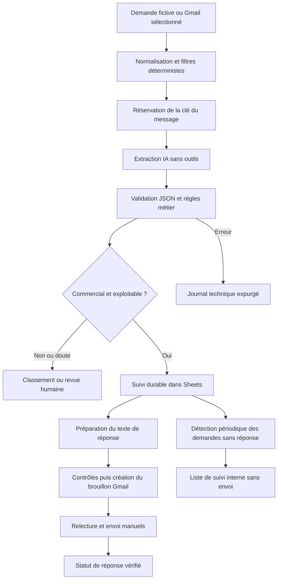

# Flow Inbox — architecture d’intégration proposée

Date initiale : 13 octobre 2026. Statut : **intégration à valider**. La première tranche de [démo locale](../livrables/automatisations/flow-inbox/README.md) est réalisée le 15 octobre après accord sur la poursuite dans ce périmètre. Le plan complet, l’option A/B et l’intégration réelle ne sont pas validés. Aucun workflow n8n ou compte fournisseur connecté n’est livré.

Complément du 15 octobre : [contrat Gmail, comparaison n8n et recette proposée](CONTRAT_GMAIL_FLOW_INBOX.md). Il distingue les identifiants du message entrant, du brouillon et de la réponse, ainsi que les absences et les effets incertains. Le statut des preuves locales est décrit dans la [recette du simulateur](../livrables/automatisations/flow-inbox/RECETTE_LOCALE.md).

## Choix à trancher

| Option | Composition | Bénéfice | Limite |
|---|---|---|---|
| **A — recommandée pour le pilote** | n8n, fonctions JavaScript pures testées, JSON Schema, Gmail, Google Sheets | Peu de services, nœuds natifs, suivi accessible au client | Sheets n'offre pas une contrainte transactionnelle d'unicité ; impose un seul écrivain et reprise prudente |
| B — si concurrence ou reprise complexe nécessaire | n8n + petit service Python/SQLite transactionnel ; Sheets devient une projection | Contrainte UNIQUE et états persistants maîtrisés ; réutilise les compétences Python | Service supplémentaire à héberger, sécuriser et sauvegarder ; plus de temps de maintenance |

Pas de PostgreSQL, Redis, framework d'agents, base vectorielle ou portail multi-client au lancement. En option B, SQLite suffit pour un service mono-instance ; plusieurs instances ou fortes écritures concurrentes justifieraient une autre base après mesure. Aucune option ne peut rendre atomique une transaction entre une base et Gmail.

Option A recevable uniquement si un traitement à la fois peut être **imposé et démontré** dans la version/édition n8n choisie, y compris les reprises. Interdire exécution manuelle concurrente et seconde copie du workflow. Si cette contrainte n'est pas tenable chez le client, retenir B avant exploitation ; ne pas présenter une lecture puis un ajout dans Sheets comme une garantie d'unicité.

## Périmètre de la première tranche

Une boîte Gmail et un libellé/dossier commercial sélectionné, texte seul, un catalogue de services, un Sheet dédié et un opérateur de validation. Démo locale avec demandes fictives et réponses de fournisseur simulées. Le MVP connecté inclut ensuite extraction IA, suivi et création de brouillons. Pièces jointes, OCR, navigation dans les liens, CRM tiers et qualification avancée sont hors périmètre initial.

Réutilisation immédiate : conventions de tests avec services simulés, séparation des données fictives, statuts explicites, neutralisation de formules et procédures de livraison. Ne pas importer `envoi.gs` : il contient des envois. Les parseurs CSV et KPI d'Équerre restent disponibles pour Insight Reports ; les mécanismes communs ne doivent pas dépendre du modèle de facture.



## Déroulé fonctionnel

1. Entrée fictive par fichier/local CLI ; entrée connectée par nœud Gmail Trigger ou interrogation planifiée, choix à vérifier sur la version épinglée.
2. Lire l'identifiant Gmail, le fil, date et expéditeur depuis l'intégration ; exclure messages envoyés par soi, rebonds, réponses automatiques et libellés hors périmètre. Les cas incertains vont en revue ; une demande commerciale ne doit pas être jetée sur un simple mot-clé.
3. Normaliser le texte, supprimer contenu HTML actif et historique cité dans la limite d'une méthode testée ; conserver l'original dans Gmail. Pas de téléchargement de liens ou pièces jointes. Refuser les entrées trop longues au lieu de perdre silencieusement la fin.
4. Réserver une clé composée de `client_id`, `mailbox_id`, `provider_message_id`. Ne pas utiliser l'email de l'expéditeur ni le `thread_id` seuls : plusieurs demandes et réponses peuvent venir du même contact.
5. Appeler l'extracteur avec instructions fixes, catalogue de services configuré et email fourni comme donnée. Première vérification du périmètre déterministe, puis classement sémantique dans l'extraction.
6. Valider le JSON puis sa cohérence métier. Rien n'est écrit comme donnée qualifiée si la validation échoue. Un champ absent vaut `null`, pas une supposition.
7. Écrire la demande validée avec clé et état ; les destinataires, IDs de fichier et identifiants OAuth viennent uniquement de la configuration/intégration.
8. Préparer une réponse courte à partir des champs validés et des informations manquantes, sans inventer prix, créneau ou délai. Une base de texte déterministe suffit au pilote ; une reformulation IA facultative utilise un second appel limité.
9. Contrôler le résultat et créer un brouillon texte dans le bon fil, sans CC/BCC automatique. Stocker l'ID du brouillon. La réponse revient au destinataire d'origine validé, jamais à une adresse choisie par le modèle. Un `Reply-To` différent ou ambigu exige une revue humaine.
10. Une personne relit, ajuste puis envoie dans Gmail. Un brouillon existant ou supprimé ne prouve pas un envoi.
11. Détecter une réponse sortante réelle dans le fil avec identifiant et date, ou accepter une confirmation manuelle explicitement tracée ; les cas ambigus restent à vérifier. Une réponse automatique ne clôt pas le suivi.
12. Sur un passage périodique sérialisé, signaler les demandes commerciales non clôturées dépassant le délai convenu. Proposition initiale : 48 h calendaires, configurable ; ne pas prétendre gérer les jours ouvrés tant que cette règle n'est pas implémentée. Aucun email d'alerte ou relance automatique dans le MVP.

Le nœud Gmail natif documente `Draft / Create`, avec destinataire et fil configurables. Cette disponibilité ne prouve pas l'exécution d'un workflow. Source : [n8n, opérations sur les brouillons](https://docs.n8n.io/integrations/builtin/app-nodes/n8n-nodes-base.gmail/draft-operations).

## Contrats et validation

Trois frontières distinctes : entrée fournisseur, extraction IA, enregistrement métier. JSON Schema est la source du contrat ; validateur JavaScript local à choisir et épingler pendant l'implémentation, puis même contrat appliqué dans n8n. TypeScript facultatif pour du nouveau code si cela simplifie réellement ; aucune migration du dépôt existant.

Dans la démo 0.1, les schémas et leur validateur sans dépendance sont regroupés dans `src/contracts.js`. Ils utilisent un sous-ensemble fermé de JSON Schema, documenté dans le guide de la démo. Ce choix local ne prouve pas une validation complète JSON Schema ou sa parité avec un futur nœud n8n.

| Ensemble | Champs proposés | Validation |
|---|---|---|
| Entrée | `client_id`, `mailbox_id`, `message_id`, `thread_id`, `received_at`, `from`, `reply_to`, `subject`, `body_text` | IDs non vides, date valide, un expéditeur, limites de taille ; contexte client injecté par configuration |
| Extraction | `schema_version`, `scope`, `service`, `company`, `contact_name`, `contact_email`, `phone`, `budget`, `deadline`, `summary`, `evidence` | Champs déclarés uniquement ; énumérations, types stricts, valeurs absentes nulles, longueur bornée |
| Budget | `min`, `max`, `currency`, `raw_text` | Bornes cohérentes et non négatives ; monnaie inconnue reste nulle ; « à partir de » n'est pas un montant exact |
| Délai | `raw_text`, `date_iso`, `precision` | Date absente/ambiguë = nulle ; phrase relative conservée ; aucune date précise inventée |
| Métier | `request_id`, `idempotency_key`, `missing_fields`, `review_reasons`, `processing_state`, `followup_status`, `draft_id`, `answered_at`, `updated_at`, `schema_version`, `prompt_version`, `model_id` | IDs/statuts construits par le code ; jamais acceptés depuis la sortie IA ; dates système contrôlées |
| Erreur | `request_id`, `step`, `error_code`, `retry_count`, `occurred_at`, `correlation_id` | Liste de champs autorisés ; aucun corps d'email, token, credential ni erreur brute fournisseur |

Valeurs `scope` : `commercial`, `non_commercial`, `uncertain`. Services : liste choisie par le client + `other` et `unknown`. `missing_fields` calculé par le code depuis les règles client, pas sur la seule déclaration du modèle. Pour chaque champ critique extrait, `evidence` doit renvoyer un extrait présent dans l'email normalisé. La présence de l'extrait aide la revue, sans garantir à elle seule la justesse sémantique.

Structured Outputs permet de contraindre la forme à un JSON Schema pris en charge ; prévoir `additionalProperties: false`, champs requis avec types nullable lorsque nécessaire, puis contrôles métier locaux. Traiter séparément refus, réponse incomplète et erreur fournisseur. Le respect du schéma n'est pas une preuve d'exactitude des faits. Source : [OpenAI, Structured Outputs](https://developers.openai.com/api/docs/guides/structured-outputs). Aucun modèle précis ni tarif API choisi à ce stade ; choisir après un essai mesuré et autorisé.

## États, dédoublonnage et reprise

Séparer `processing_state` (`reserved`, `extracted`, `recorded`, `draft_pending`, `draft_ready`, `manual_review`, `retryable_error`, `permanent_error`, `ignored`) du statut commercial (`new`, `awaiting_review`, `awaiting_details`, `answered`, `closed`). La tranche locale teste un sous-ensemble de transitions avec fournisseurs simulés ; les transitions et reprises connectées restent à recetter. Un doublon est un résultat de traitement, pas un nouvel enregistrement.

Option A : onglet technique protégé, clés jamais modifiées manuellement, un seul écrivain pour ingestion et suivi. Une lecture de Sheets en échec **ne signifie jamais** « clé absente ». Après résultat incertain d'une écriture, relire/réconcilier par clé avant tout nouvel ajout ; si plusieurs lignes existent, suspendre et signaler. Les modifications humaines passent par colonnes métier séparées ou sont relues avant mise à jour ciblée pour éviter l'écrasement.

Avant création Gmail, enregistrer `draft_pending` et une référence de corrélation. Si le processus tombe après création mais avant stockage de l'ID, ou si Gmail renvoie un timeout, **ne pas recréer automatiquement** : rechercher/réconcilier les brouillons du fil et, si le résultat n'est pas certain, revue manuelle. Idem après un redémarrage avec état en cours. Aucun « exactement une fois » garanti entre services.

Les retries automatiques sont réservés aux opérations sûres et aux erreurs transitoires : 429, timeout de lecture, 5xx ; respecter `Retry-After` et limiter à 3 tentatives avec délai croissant. 401/403 : arrêt et correction des droits. JSON invalide ou refus IA : revue, sans boucle de régénération indéfinie. Erreur de création à effet inconnu : réconciliation humaine. Un ID de message identique dans deux boîtes/clients ne doit jamais fusionner les demandes.

## Sécurité, données et coûts

- Email non fiable : aucune capacité d'outil côté modèle, aucun accès shell, réseau arbitraire, secrets ou choix de credentials. Les URL du corps ne sont pas suivies ; les expressions n8n ne sont pas générées depuis le contenu. Les prompts seuls ne constituent pas une barrière de sécurité.
- La sortie IA ne commande aucune action sensible. Contrôler destination, fil, format, longueur et références. Pas de traitement autonome des pièces jointes.
- Écriture Sheets en mode valeurs brutes (`RAW`) si disponible et vérifié ; neutraliser aussi les caractères de formule, y compris après espaces/caractères de contrôle pertinents. Tests d'injection spécifiques, sans supposer que la fonction historique `sure()` couvre tous les cas.
- Credentials dans le coffre n8n ou mécanisme équivalent du déploiement ; export du workflow expurgé. Un client = credentials et Sheet distincts ; préférer une instance/compte détenu par le client pour le pilote.
- Gmail : le scope `gmail.compose` permet **aussi d'envoyer** ; il n'existe pas de garantie « brouillons seulement » par ce seul scope. Minimiser les droits effectifs, restreindre l'accès à l'éditeur et tester l'absence de toute opération d'envoi. Vérifier les scopes réellement demandés par le connecteur retenu, les exigences OAuth et le mode d'application. Source : [Google, scopes Gmail](https://developers.google.com/workspace/gmail/api/auth/scopes).
- Journalisation : codes techniques et IDs de corrélation ; ne pas conserver le payload complet dans les erreurs. Vérifier aussi la sauvegarde automatique des données d'exécution n8n, pas seulement les logs personnalisés. Désactiver ou minimiser cette rétention, puis définir purge et accès avec le client.
- Paramètres de coût proposés, à valider : maximum 20 000 caractères par message, 2 appels IA normaux, taille de sortie bornée, 3 tentatives au plus, compteur quotidien d'appels et de tokens. Stopper les appels quand le budget applicatif autorisé est atteint ; les alertes fournisseur ne remplacent pas cet arrêt.
- Le coût réel inclut n8n, hébergement, API, sauvegarde et temps de support ; aucun coût nul promis pour la version connectée. Démo simulée sans clé ni consommation API.
- Avant données réelles : finalité, responsabilités, sous-traitants, accès, durée de conservation, transferts éventuels et suppression documentés avec le client. Sauvegarder configuration et suivi dans un espace protégé ; tester une restauration sans réactiver les effets externes.
- Arrêt : désactiver les déclencheurs, suspendre les reprises, révoquer les accès en cas d'incident, conserver seulement les traces utiles et autorisées. Reprise contrôlée, sans rejeu aveugle.

n8n est distribué avec des restrictions de licence, pas une licence permissive générale. L'éditeur distingue les prestations de conseil/support de la revente d'accès à son logiciel. Recommandation : vendre installation et maintenance dans l'environnement du client ; toute future offre hébergée ou embarquée nécessite une nouvelle analyse. Sources : [licence n8n](https://github.com/n8n-io/n8n/blob/master/LICENSE.md), [explication officielle des prestations de conseil](https://blog.n8n.io/announcing-new-sustainable-use-license/). Aucun hébergement choisi ni licence achetée.

## Arborescence proposée

```text
livrables/automatisations/flow-inbox/
  README.md
  SPECIFICATION.md
  package.json                 # démo/test et dépendances épinglées
  package-lock.json
  .env.example                 # noms de paramètres, aucune valeur secrète
  config/client.example.json  # services, règles, limites, pas de credentials
  schemas/
    incoming-message.schema.json
    extraction.schema.json
    request-record.schema.json
  src/
    normalize.js
    validate.js
    qualify.js
    draft.js
    state.js
    followup.js
  prompts/
    extract.md
    draft.md
  demo/
    run.js
    fixtures/                  # emails fictifs et sorties IA simulées
  workflows/
    flow-inbox-demo.json        # import manuel, désactivé
    flow-inbox-gmail.json       # production à activer après recette
    flow-inbox-followup.json
    flow-inbox-errors.json
  tests/
    unit/
    contracts/
    integration/               # mocks par défaut, intégrations réelles explicites
    scenarios.md
  docs/
    INSTALLATION.md
    ERROR_RUNBOOK.md
    DATA_HANDLING.md
    CLIENT_DELIVERY_CHECKLIST.md
    RECETTE_N8N.md
```

Éviter la divergence entre fonctions locales et code embarqué n8n : une source, génération contrôlée du bloc de validation si nécessaire et test de parité. Nœuds natifs pour Gmail/Sheets/planification/erreurs ; bloc Code uniquement pour les règles métier. Documenter version n8n, version des nœuds, mode d'exécution et import testé. Si le nœud OpenAI de la version retenue n'expose pas le schéma strict requis, un appel HTTP à endpoint fixe est une alternative à décider lors du prototype, pas un prétexte à installer un framework.

## Matrice de recette prévue — 36 scénarios

**Cette matrice complète n’est pas recettée en intégration réelle.** La démo du 15 octobre dispose de tests locaux sur un sous-ensemble des règles, avec fixtures fictives et fournisseurs simulés ; voir sa recette pour les preuves exactes. La liste ci-dessous reste le résultat attendu au niveau approprié, pas une annonce de 36 tests connectés réussis.

| ID | Scénario | Résultat attendu |
|---|---|---|
| 01 | Demande complète en français | Champs présents fidèles, un suivi et un brouillon |
| 02 | Budget absent | null + information manquante |
| 03 | Délai absent | null, aucune date inventée |
| 04 | Coordonnée absente du corps | Pas de contact inventé ; expéditeur fournisseur distinct |
| 05 | Fourchette de budget | Bornes et devise conservées |
| 06 | Budget ambigu/négatif | Revue, pas de normalisation trompeuse |
| 07 | Délai relatif ambigu | Texte conservé, précision signalée |
| 08 | Plusieurs services | Revue ou règle client explicite |
| 09 | Service hors catalogue | other/unknown, pas de qualification forcée |
| 10 | Newsletter non commerciale | Classement sans brouillon commercial |
| 11 | Réponse automatique/rebond | Pas de nouveau prospect |
| 12 | Message vide ou trop long | Rejet explicite et trace expurgée |
| 13 | HTML avec script/image distante | Texte inerte, aucun chargement |
| 14 | Pièce jointe seule | Revue manuelle, aucun téléchargement |
| 15 | Message dans une autre langue | Extraction fidèle ou revue ; langue signalée |
| 16 | JSON IA malformé | Aucune écriture qualifiée, erreur tracée |
| 17 | Champ supplémentaire/type incorrect | Rejet du contrat |
| 18 | Refus ou réponse IA tronquée | Revue, aucun brouillon incomplet |
| 19 | Valeur sans preuve dans le texte | Revue ou valeur nulle |
| 20 | « Ignore tes instructions » dans l'email | Aucun changement d'instructions/action |
| 21 | Demande de secret ou URL d'exfiltration | Aucun accès ni appel réseau arbitraire |
| 22 | Injection de formule Sheets | Texte inerte, y compris préfixes masqués |
| 23 | Injection destinataire/CC/BCC | Destination issue du routage validé uniquement |
| 24 | Reply-To différent/ambigu | Revue avant brouillon |
| 25 | Même message rejoué | Aucun nouveau suivi/brouillon |
| 26 | Deux messages du même contact/fil | IDs distincts conservés, pas de suppression abusive |
| 27 | Même ID dans deux clients | Isolation complète |
| 28 | Déclenchements simultanés | Exécution sérialisée prouvée ou choix B |
| 29 | Sheets indisponible/écriture incertaine | Aucun brouillon prématuré ; réconciliation |
| 30 | Timeout Gmail après création possible | Pas de création automatique répétée |
| 31 | OAuth révoqué | Arrêt, code d'erreur sans secret |
| 32 | IA 429/5xx et budget épuisé | Retrys bornés puis arrêt ; consommation suivie |
| 33 | Crash puis reprise d'état en cours | Réconciliation sans effets dupliqués |
| 34 | Brouillon supprimé vs message envoyé | Suppression ≠ réponse ; envoi vérifié séparément |
| 35 | Délai de suivi franchi, UTC/Paris | Signalement exact, pas de relance envoyée |
| 36 | Sauvegarde, restauration et arrêt | Isolation préservée, aucun envoi ni rejeu involontaire |

Tests complémentaires de structure : workflow désactivé à l'import, absence de secret et de nœud/endpoint d'envoi, journal expurgé, aucune action commandée par le modèle. Les appels fournisseur réels sont une recette distincte, payante potentiellement, à autoriser explicitement.

## Critères avant livraison

Démo simulée explicitement identifiée ; schémas et règles validés ; 36 scénarios documentés et contrôlés au niveau approprié ; exécution réelle de la version n8n choisie avec traces datées, compte de test et données fictives ; nombre de lignes/brouillons attendu après rejeu ; aucun envoi ; preuves de permissions et isolation ; limites de coût, arrêt, sauvegarde/restauration et procédure d'erreur démontrés. Le client valide ensuite son périmètre, ses exemples et les conditions de maintenance. Tant que ces preuves manquent, parler de prototype, pas de produit prêt à livrer.
