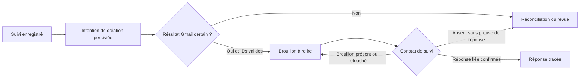

# Flow Inbox — contrat Gmail et recette proposée

15 octobre 2026. Étude documentaire et spécification proposée, complément de l’[architecture](ARCHITECTURE_FLOW_INBOX.md). Aucun appel Gmail, workflow n8n ou test d’intégration exécuté. Suite à la demande de poursuivre après clarification du coût, la première tranche locale est réalisée : [démo et guide](../livrables/automatisations/flow-inbox/README.md), [recette locale](../livrables/automatisations/flow-inbox/RECETTE_LOCALE.md). Les règles ci-dessous cadrent l’intégration future ; elles ne tranchent pas A/B et toutes ne sont pas prouvées par le simulateur.

## Résultat recherché

Pour une demande sélectionnée : conserver son identité, enregistrer le suivi avant tout effet Gmail, créer au plus un brouillon dont l’existence est certaine, puis laisser une personne relire et envoyer. Après un effet incertain, suspendre la création et réconcilier. Le système ne doit ni écraser une retouche humaine ni confondre brouillon disparu et réponse envoyée.

## Faits documentés, distincts des choix du projet

| Observation documentaire | Conséquence à examiner | Source primaire |
|---|---|---|
| Le conteneur du brouillon possède un ID stable ; son message est remplacé lors des mises à jour. À l’envoi, le brouillon disparaît et un nouveau message porte `SENT`. | Suivre séparément demande, brouillon et sortie. La disparition seule ne confirme rien. | [Google, brouillons](https://developers.google.com/workspace/gmail/api/guides/drafts) |
| Le rattachement au fil demande `threadId`, des en-têtes `References` / `In-Reply-To` conformes et un sujet correspondant. | Ne pas supposer qu’un seul `threadId` suffit. | [Google, fils](https://developers.google.com/workspace/gmail/api/guides/threads) |
| La ressource Message distingue `id`, `threadId`, en-têtes et `internalDate`. Ce dernier représente la création interne ; sa provenance diffère pour des emails importés. | Distinguer identifiants API et MIME, dates fournisseur et dates de constat. | [Google, Message](https://developers.google.com/workspace/gmail/api/reference/rest/v1/users.messages) |
| `drafts.create` reçoit un Draft et retourne un Draft en cas de succès. | Valider le résultat retourné avant de déclarer le brouillon prêt. | [Google, création](https://developers.google.com/workspace/gmail/api/reference/rest/v1/users.drafts/create) |
| Le nœud Gmail n8n documente une opération Draft / Create et des options de destinataire et de fil. | Vérifier le MIME et le fil réellement produits dans la version choisie. | [n8n, brouillons](https://docs.n8n.io/integrations/builtin/app-nodes/n8n-nodes-base.gmail/draft-operations) |

Ces pages n’établissent pas le comportement de notre future intégration, ni celui de chaque interface Gmail lors d’une retouche humaine. La recette doit le constater sur le compte de test autorisé.

## Identités proposées

Les valeurs de routage viennent de la configuration et de l’intégration, jamais d’une adresse ou d’un identifiant choisi par l’IA. Les en-têtes reçus restent des données à valider, pas des instructions.

| Champ métier proposé | Origine / usage |
|---|---|
| `client_id`, `mailbox_id` | Configuration de l’environnement concerné, contrôlée avant lecture/écriture |
| `provider_message_id` | `Message.id` entrant ; correspond au `message_id` de l’entrée proposée dans l’architecture |
| `thread_id` | Fil fournisseur de cette demande, pas une clé unique de demande |
| `rfc_message_id`, `rfc_references` | En-têtes MIME entrants validés ; **ne pas y substituer l’ID API Gmail** |
| `request_id`, `idempotency_key` | Construits par le code ; clé fondée sur le triplet client / boîte / message, avec encodage non ambigu |
| `draft_id`, `draft_message_id` | Identité du brouillon et ID du message qu’il contient lors du dernier constat ; ce dernier peut changer |
| `outbound_message_id` | Identité du message sortant retenu comme preuve, distincte des deux précédentes |
| `confirmation_source`, `confirmed_at` | `gmail_verified` ou `human_declared`, avec date du constat et référence de preuve ; une déclaration humaine n’est pas une vérification Gmail |

Ces champs complètent la proposition ; aucun schéma exécutable n’est créé par ce document. Les IDs, adresses et en-têtes réels restent dans le stockage client protégé, hors des documents et journaux versionnés. Dates fournisseur, dates de traitement et date de confirmation sont séparées.

## Règles applicatives proposées

**Contexte initial.** Texte normalisé du message courant et catalogue/consignes validés du client. La consultation technique du fil pour identifier une réponse n’autorise pas à transmettre tout l’historique au modèle. Un besoin de contexte supplémentaire exige un nouveau cadrage.

**Rattachement.** Préparer le brouillon pour l’expéditeur validé, sans CC/BCC automatique. `Reply-To` divergent, en-tête ambigu, caractères de contrôle ou référence MIME inexploitable : revue humaine, aucune création automatique. Vérifier la sérialisation MIME, les en-têtes de réponse et le sujet sur le connecteur retenu ; ne pas concaténer aveuglément un préfixe au sujet. Si le nœud ne permet pas de satisfaire le contrat, consigner le blocage avant de choisir une alternative.

**Ordre des effets.** Réserver la demande, enregistrer les données validées et l’intention `draft_pending`, puis créer le brouillon. Tant qu’une écriture de suivi est incertaine, ne pas passer à Gmail. Après succès Gmail, mémoriser les IDs ; un résultat incomplet ou une panne avant leur stockage déclenche une réconciliation, pas un nouvel appel de création.

**Retouches.** Après création, ne pas réécrire ou régénérer automatiquement le brouillon. Le rechargement peut actualiser son identité de message et son état observé, sans écraser son texte. Si un autre message arrive dans le même fil alors qu’un brouillon est en cours, conserver la nouvelle demande distincte et faire revoir le traitement ; ne pas multiplier les brouillons contradictoires ou clore toutes les demandes du fil.

**Réponse.** La présence d’un message sortant dans le même fil ne suffit pas à fermer une demande. Examiner `SENT`, la boîte concernée, la chronologie, les destinataires et la référence à la demande ; exclure les réponses automatiques identifiées. Un lien insuffisant ou plusieurs candidates restent à vérifier. Une confirmation manuelle explicite constitue une preuve distincte, tracée comme telle. Une réponse constatée n’implique ni devis, ni vente, ni encaissement.

## États et transitions attendus

Conserver les `processing_state` et `followup_status` proposés dans l’architecture. Ajouter des observations du brouillon et de la réponse plutôt que de remplacer tous les états par un unique « traité ». Les noms techniques des nouveaux champs seront fixés avec les schémas.

| Événement | État attendu / action |
|---|---|
| Demande déjà réservée ou traitée, même clé | Relire l’état ; aucun nouvel enregistrement ou brouillon aveugle |
| Création réussie, IDs validés et stockés | `draft_ready`, suivi en attente de relecture ; `answered_at` reste absent |
| Retouche humaine | Brouillon toujours à relire ; préserver la retouche même si son `message.id` change |
| Brouillon absent lors d’une lecture réussie | Absence constatée ; ne conclure ni suppression volontaire ni envoi ; réconcilier |
| Lecture refusée, partielle ou en échec | Ne pas transformer le résultat en « absent » ; arrêt sur droits révoqués, reprise bornée pour lecture transitoire |
| Création potentielle, timeout ou crash | Effet incertain ; état de revue/réconciliation avant toute nouvelle création |
| Réponse liée vérifiée ou déclaration humaine explicite | Statut de réponse et preuve séparée mis à jour ; ne pas fermer automatiquement les autres demandes |

Pour une recherche de rapprochement, parcourir toutes les pages utiles ou déclarer le résultat incomplet. Ne jamais utiliser l’absence dans la première page comme preuve d’absence. La stratégie de corrélation entre une création Gmail et son suivi doit être choisie et testée ; aucun marqueur secret ou texte du client dans les logs. Les limites de tentatives, l’isolation et l’écriture unique restent celles de l’architecture proposée.

## Comparaison bornée avec le template n8n 15953

Observation de la [description publique](https://n8n.io/workflows/15953-triage-gmail-emails-draft-ai-replies-and-log-to-google-sheets-with-gpt-4o/), pas de son JSON ni de son exécution. Elle annonce une réception Gmail, un classement urgent/non urgent, un brouillon pour les urgences, puis une ligne Sheets par message. Elle ne suffit pas à prouver la fiabilité des branches d’erreur.

| Point | Description du template | Proposition Flow Inbox |
|---|---|---|
| Qualification | Urgence | Besoin commercial, service, informations présentes/manquantes ; urgence seule insuffisante |
| Ordre annoncé | Brouillon puis journal Sheets | Suivi durable et intention enregistrés avant brouillon |
| Preuve d’état | Indication qu’un brouillon a été créé | IDs distincts, état observé et preuve de réponse séparée |
| Déduplication, panne, retouche | Garanties non établies par la page | Réservation, réconciliation et préservation de la retouche à recetter |
| Appels modèle | Classement et rédaction annoncés | Extraction bornée ; texte déterministe possible, reformulation facultative |

Conclusion de conception : reprendre l’idée des étapes, pas importer le template comme produit prêt. Aucun modèle, fréquence de déclenchement ou tarif tiers retenu à partir de cette page. Aucun JSON téléchargé ou importé.

## Recette d’intégration à préparer — couverture locale séparée

Toutes les données de recette sont ou seront fictives. La colonne « preuve future » décrit le niveau de preuve attendu ; la couverture locale actuelle de G01–G12 est précisée dans la recette locale liée en tête de document. Les 62 tests du simulateur ne constituent pas des preuves Gmail/n8n.

| ID | Scénario | Résultat attendu | Preuve future |
|---|---|---|---|
| G01 | Demande admissible, références valides | Un suivi et un brouillon dans le bon fil ; aucun envoi | Contrat local + Gmail/n8n |
| G02 | ID API placé à la place du `Message-ID` MIME, ou injection d’en-tête | Rejet/revue avant création | Local + sérialisation réelle |
| G03 | Même clé rejouée | Aucun effet supplémentaire | Simulation + rejeu Gmail/n8n |
| G04 | Même ID fournisseur dans deux clients | États indépendants | Local + isolation des comptes |
| G05 | Brouillon retouché humainement | Texte préservé, association conservée | Simulation puis Gmail |
| G06 | Brouillon supprimé sans réponse | Aucune réponse déclarée, aucune recréation automatique | Simulation puis Gmail |
| G07 | Brouillon envoyé manuellement dans le bac à sable autorisé | Nouvelle sortie rapprochée et preuve enregistrée | Gmail, autorisation distincte de cet envoi de test |
| G08 | Ancienne sortie ou sortie sans lien clair dans le même fil | Aucune clôture abusive ; revue si doute | Local + Gmail |
| G09 | Nouveau message reçu dans un fil avec brouillon actif | Nouvelle clé conservée, revue du fil | Local + Gmail/n8n |
| G10 | Écriture Sheets en échec ou incertaine | Aucun brouillon créé prématurément | Simulation puis n8n |
| G11 | Gmail crée potentiellement, réponse perdue avant stockage ID | Réconciliation, aucune répétition aveugle | Injection de panne simulée puis recette contrôlée |
| G12 | Lecture paginée incomplète ou accès révoqué | Aucune fausse absence ni faux statut répondu | Simulation puis Gmail/n8n |

Ces cas précisent notamment les scénarios 23–34 de la matrice initiale ; ils ne remplacent pas les autres exigences de contenu, de coût, de sauvegarde et d’arrêt. Les preuves réelles devront indiquer version n8n/nœud, date, cas, états et IDs fictifs ou expurgés, sans contenu personnel ni credential.

## Première tranche locale réalisée

Démo locale JavaScript indépendante, dans `livrables/automatisations/flow-inbox/`, sans dépendance réseau : fixtures d’emails fictifs et d’extractions simulées, fonctions de validation/routage/états, suivi simulé et brouillons texte locaux, commande de démonstration et tests des règles effectivement implémentées. Aucun parseur sémantique prétendant remplacer une IA : les extractions simulées seront déclarées comme telles.

Montrer au minimum demande avec informations manquantes, entrée invalide, rejeu, brouillon retouché/disparu et création incertaine. Un fichier local ne sera jamais présenté comme un brouillon Gmail. La recette réelle, n8n, OAuth, appels IA, dépenses et activation restent une tranche distincte. L’option A demeure la base d’intégration proposée, conditionnée à la sérialisation prouvée ; l’accord sur la démo seule ne prouve pas sa faisabilité connectée.

La demande de poursuivre après présentation du périmètre et clarification du coût est retenue comme accord pour cette tranche locale. Elle n’autorise pas la connexion de comptes, les dépenses, l’envoi de test réel ou l’activation d’un workflow. Les autres validations de [AGENTS.md](../AGENTS.md) restent applicables.

Contrôles documentaires réalisés : six documents UTF-8, 25 liens locaux résolus, douze identifiants de recette uniques et blocs de code fermés ; aucune erreur. `git diff --check` réussi. Aucun test applicatif ou Gmail/n8n exécuté pour ce livrable ; le diagramme Mermaid n’a pas fait l’objet d’une validation par moteur de rendu.
