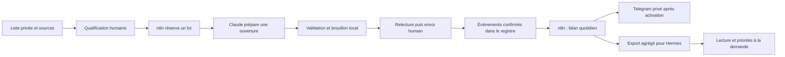

# Pipeline agence — n8n, Claude et supervision Hermes

17 octobre 2026 · version locale 0.1. **Construite et testée localement ; exports n8n générés mais non importés ni exécutés dans une instance n8n.** Claude, Telegram et Hermes n'ont pas été appelés. Aucun prospect réel n'est importé par la démo.

## Rôles et parcours



- **n8n** orchestre préparation et bilan. Deux exports inactifs, mode demo et livraison Telegram coupée par défaut.
- **Claude via API Anthropic** prépare une phrase d'ouverture à partir d'un fait sourcé. Le reste du message provient d'un modèle explicite, propre à Flow Inbox ou à l'e-facture. Le modèle ne choisit aucun destinataire ni outil.
- **Registre Python/SQLite** : unicité, réservation, brouillons, oppositions, événements confirmés et calculs. Petit composant local sans framework ni dépendance métier externe ; SQLite permet une réservation transactionnelle que ne garantit pas un simple aller-retour dans Sheets.
- **Hermes** aide à lire les agrégats et proposer des priorités. Les [instructions de supervision](hermes/INSTRUCTIONS.md) sont prêtes. Aucune invocation automatique de Hermes, installation, passerelle ou cron Hermes n'est faite ici.

Ce livrable concerne la **prospection interne de l'agence**, pour les deux services. Il ne remplace pas le produit Flow Inbox ni son contrat Gmail.

Kit de rédaction : [charte Hermes](hermes/CHARTE_REDACTION.md), [textes de prospection, réponses et bilan](hermes/MODELES_MESSAGES.md), [prompt d'ouverture](hermes/PROMPT_OUVERTURE.txt). Le prompt est chargé directement par le registre ; les corps enrichis restent des modèles à relire et à intégrer au rendu avant utilisation. Aucun texte de ce kit n'active un envoi ou une relance.

## Fichiers livrés

| Fichier | Usage |
|---|---|
| [01-preparation.json](n8n/01-preparation.json) | Import n8n : lot approuvé → Claude simulé ou API explicitement configurée → brouillon local |
| [02-bilan-quotidien.json](n8n/02-bilan-quotidien.json) | Import n8n : agrégats → aperçu ; branche Telegram prête à configurer |
| [pipeline.py](pipeline.py) | Registre et commandes locales |
| [bridge.py](bridge.py) | Pont HTTP authentifié, limité à `127.0.0.1` |
| [generate_workflows.py](generate_workflows.py) | Source des deux exports n8n, régénérables |
| [Instructions Hermes](hermes/INSTRUCTIONS.md) | Lecture seule d'un dossier d'agrégats séparé |
| [Recette](RECETTE.md) | Vérifications effectuées et intégrations restant à tester |

## Essai immédiat, sans compte ni coût API

Depuis ce dossier, avec Python 3.10+ et la base de fuseaux horaires disponible :

```powershell
python pipeline.py demo
python pipeline.py queue
python pipeline.py report --out runtime/rapports-demo
```

Dans la session Windows examinée, Python n'est pas sur le PATH ; utiliser à la place `& "$env:USERPROFILE\miniconda3\python.exe"` suivi des mêmes arguments. Si `Europe/Paris` n'est pas disponible sur une autre installation Python, installer/configurer les données de fuseaux avant l'essai ; aucune date ne doit dépendre silencieusement du fuseau de l'hôte.

La démo importe trois entreprises fictives, dont deux approuvées. Elle prépare deux brouillons locaux, zéro envoi et zéro encaissement. Relancer la commande conserve le registre et ne recrée pas les brouillons. Les chiffres du jour dépendent de la date d'exécution ; consulter un jour historique avec `report --day AAAA-MM-JJ`.

Tous les fichiers `runtime/` sont ignorés par Git. Ne pas placer de données réelles dans les fixtures.

## Essayer le parcours n8n en mode demo

1. Préparer un registre de démonstration distinct, encore sans brouillons :

   ```powershell
   python pipeline.py --db runtime/n8n-demo.sqlite seed-demo
   ```

2. Définir un token local aléatoire de 24 caractères minimum dans `AGENCY_BRIDGE_TOKEN`, via le gestionnaire de secrets ou l'environnement du processus. Ne pas utiliser une valeur versionnée, le mettre dans une URL ou l'afficher. Aucun fichier `.env` n'est lu par ces scripts.
3. Lancer le pont dans un terminal séparé :

   ```powershell
   python bridge.py --db runtime/n8n-demo.sqlite --report-dir runtime/rapports-n8n-demo
   ```

4. Importer les deux JSON dans n8n. Les garder inactifs. Sélectionner sur les nœuds du pont un credential **Header Auth**, nom d'en-tête `Authorization`, valeur `Bearer ` suivie du token, saisi uniquement dans le coffre n8n.
5. Garder `mode:'demo'`, le modèle placeholder et `send_telegram:false`. Exécuter manuellement **Agence 01**, puis lire la queue avec :

   ```powershell
   python pipeline.py --db runtime/n8n-demo.sqlite queue
   ```

6. Exécuter manuellement **Agence 02** pour voir le bilan et produire les seuls agrégats destinés au test Hermes.

**Réseau :** les adresses des nœuds HTTP sont fixes, `http://127.0.0.1:8791`. Cela convient à n8n et Python sur le même hôte réseau. Depuis n8n Cloud ou un conteneur, ce loopback ne désigne pas le PC Windows. Aucun tunnel ni endpoint public n'est créé ici ; choisir et sécuriser une topologie avant de modifier les URLs. Ne pas exposer ce serveur de développement directement sur Internet.

## Liste réelle et qualification : étapes séparées

Les listes préparées restent dans `prospection/prive/`. Importer seulement une liste relue dans un registre live distinct, après vérification des sources, du ciblage et des oppositions antérieures. L'import ne contacte aucun site ni service : il ne vérifie pas à lui seul la publication d'un email ni la pertinence commerciale.

```powershell
python pipeline.py --mode live --db runtime/live.sqlite import-csv CHEMIN_PRIVE.csv --offer flow_inbox
python pipeline.py --mode live --db runtime/live.sqlite candidates
python pipeline.py --mode live --db runtime/live.sqlite approve --candidate IDENTIFIANT --confirmed-by-human
```

Utiliser `--offer efacture` pour l'autre offre. Le mapping reprend les colonnes des listes du 16 octobre : `entreprise`, `email_public`, `signal_observe`, `source_activite`, `source_contact`. Les lignes sans email sont sautées et comptées ; aucune adresse n'est devinée. Les autres erreurs arrêtent tout l'import avant écriture.

L'import ne qualifie pas les lignes par défaut. `--approve` existe pour un lot entièrement vérifié par une personne, mais ne doit pas être ajouté mécaniquement. Pour les lignes déjà présentes, utiliser la commande `approve` : un réimport ne remplace ni l'approbation ni le contenu d'une fiche.

Le dédoublonnage porte sur l'adresse normalisée et le domaine de la source entreprise, toutes offres confondues. Choix conservateur : une seconde adresse ou un second établissement sur le même domaine reste à examiner hors de cet import. Cela ne constitue pas une identification juridique par SIREN.

Aucun scraper Google Maps/LinkedIn ni enrichisseur payant n'est livré. La qualification et le choix des sources restent une étape du processus.

## Préparer la connexion Claude

Après vérification des accès, du modèle disponible et du budget :

1. Sélectionner un credential **Header Auth** distinct sur `Claude — API Messages` : en-tête `x-api-key`, clé API Anthropic dans le coffre n8n uniquement.
2. Remplacer `CLAUDE_MODEL_A_CONFIGURER` par un identifiant de modèle accessible au compte. La liste officielle des modèles est liée ci-dessous ; aucun abonnement de chat ou accès API n'est supposé fourni.
3. Passer la configuration préparation à `mode:'live'` et lancer le pont sur le registre live avec `--mode live --enable-live-api`. Ce double réglage est nécessaire ; rien ne l'active par défaut.
4. Tester d'abord le fournisseur sur données fictives dans un workflow de recette séparé et inactif : dupliquer uniquement le nœud Claude, lui fournir la requête fictive produite par la démo et remplacer son identifiant de modèle. Ce test vérifie l'interface API sans alimenter le registre commercial. Le registre live refuse les domaines `.invalid` : ne pas assouplir ce contrôle ni fusionner des compteurs de recette avec l'activité réelle. Le test complet n8n/registre devra ensuite avoir ses fixtures et preuves distinctes.
5. Le nœud d'appel possède un timeout et aucune relance automatique. Le pont marque l'appel comme commencé avant l'effet fournisseur ; une incertitude suspend le job.

**Limites de coûts :** cinq nouveaux jobs réservés par jour, au maximum 600 tokens de sortie par appel préparé, entrée bornée et aucune recherche outillée du modèle. Les réservations non finalisées restent comptées. Ce garde-fou applicatif n'est pas un plafond financier garanti : configurer aussi les limites du compte fournisseur. Une relance manuelle directe d'un nœud API peut contourner l'étape d'autorisation : ne pas la faire. Pas de tarif, budget ou rentabilité validés ici.

Le contrat exige un JSON à deux clés (`opening`, `fact_quote`), une référence de fait exacte et aucune clé de routage. Les contrôles ne prouvent pas la vérité sémantique d'une phrase : la relecture humaine et les sources restent indispensables.

## Envoyer et suivre

La queue contient le destinataire issu du registre et le texte à relire. Copier le message dans sa messagerie après validation. **Ces workflows ne créent pas de brouillon Gmail et n'envoient aucun email.** Aucun prospect n'est marqué « envoyé » à la préparation d'un texte.

Après une action réellement constatée, enregistrer une référence de preuve privée :

```powershell
python pipeline.py --mode live --db runtime/live.sqlite record --candidate IDENTIFIANT --kind sent --event-id ID_UNIQUE --evidence REF_MESSAGE_ENVOYE --confirmed-by-human
```

Événements disponibles : `sent`, `replied`, `meeting_held`, `proposal_sent`, `signed`, `invoiced`, `payment_received`, `opposed`, `bounced`. Les références doivent être uniques ; un rejeu identique est ignoré. Les événements sont des déclarations humaines référencées, pas une lecture automatique de Gmail, de la banque ou du calendrier.

Pour un encaissement effectivement reçu : `--kind payment_received --amount-cents 49000` représente 490,00 EUR. Une facture émise ne crée aucun encaissement. Les oppositions et rebonds retirent le contact de la queue et bloquent la finalisation d'un job en attente.

Les refus et désinscriptions externes au registre doivent être reportés avant toute nouvelle préparation. Aucun paiement, rendez-vous ou envoi n'est déduit par le modèle.

## Bilan du soir, Telegram et Hermes

**n8n** : le workflow 02 prévoit 20 h dans `Europe/Paris`. Sa planification est désactivée et le workflow inactif. Le bilan se fonde sur les dates de faits enregistrées, pas sur le seul statut courant.

**Telegram** : configurer le credential du bot et l'identifiant du chat privé dans `Configuration bilan`. Vérifier le destinataire sur un essai fictif, puis autoriser explicitement `send_telegram:true` et la planification au moment retenu. Un simple bilan sortant n'a pas besoin d'un Telegram Trigger. Aucun token dans le JSON.

**Hermes** : fournir seulement le dossier d'agrégats sélectionné en lecture seule, avec les [instructions](hermes/INSTRUCTIONS.md). Il aide à comprendre le bilan après sa production. Il ne reçoit ni la base ni les coordonnées ni les clés. Cette première tranche respecte l'esprit du [cadrage existant](../../../docs/HERMES.md) : pas d'installation, de passerelle ou de cron Hermes avant essai du mode lecture seule. La livraison quotidienne n8n/Telegram et l'analyse Hermes à la demande sont deux fonctions distinctes.

## Erreur, arrêt et reprise

- Arrêter n8n ou laisser les workflows inactifs ; arrêter le pont avec Ctrl+C. Aucun workflow de fond n'est lancé par la démo.
- Après timeout Claude, vérifier le résultat fournisseur avant toute action. Si la réponse est récupérée, `complete-job --job ID --response-file REPONSE_PRIVEE.json` peut finaliser le job en appliquant les mêmes contrôles. Un résultat divergent ne remplace jamais un brouillon préparé.
- Si aucun résultat ne peut être récupéré, `cancel-job --job ID --confirmed-by-human` clôt le job. Le quota reste consommé et le prospect n'est pas automatiquement remis en file. Une nouvelle tentative est une évolution à cadrer, pas une boucle de retry implicite.
- Sauvegarder la base et les exports privés hors Git, pont arrêté. Tester une restauration sur une copie avant exploitation réelle.
- Le pont local utilise le serveur HTTP standard Python : authentification et loopback, mais pas un service de production durci. Aucun hébergement ou dispositif multi-client n'est validé.
- Les exports n8n minimisent la sauvegarde des exécutions. Vérifier ces options sur l'instance et ne pas épingler des payloads réels ; un résultat de queue peut contenir des coordonnées.

## Sources techniques

Consultées le 17 octobre 2026, pour préparer les interfaces ; elles ne prouvent pas notre intégration :

- [n8n — import/export](https://docs.n8n.io/build/manage-workflows/export-and-import).
- [n8n — requêtes HTTP](https://docs.n8n.io/integrations/builtin/core-nodes/n8n-nodes-base.httprequest).
- [n8n — planification et fuseaux](https://docs.n8n.io/integrations/builtin/core-nodes/n8n-nodes-base.scheduletrigger).
- [n8n — messages Telegram](https://docs.n8n.io/integrations/builtin/app-nodes/n8n-nodes-base.telegram/message-operations).
- [Anthropic — démarrer avec l'API](https://platform.claude.com/docs/en/get-started) et [modèles](https://platform.claude.com/docs/en/models/overview).
- [Hermes — documentation](https://hermes-agent.nousresearch.com/docs) et [passerelle Telegram](https://hermes-agent.nousresearch.com/docs/user-guide/messaging/telegram), à examiner seulement pour une phase ultérieure de connexion.
