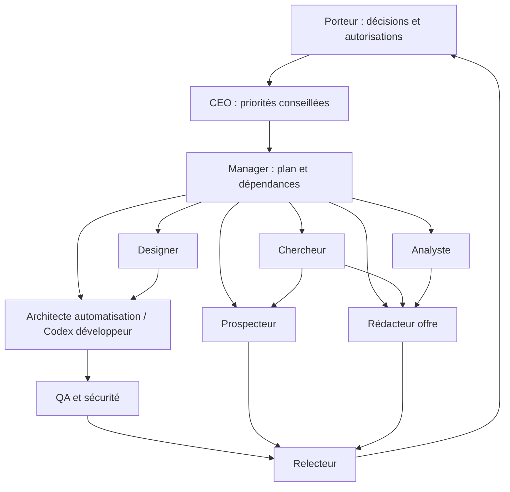

# Audit agents locaux, cinq bibliothèques et architecture Codex — 14 octobre 2026

## Que contient réellement l'équipe actuelle et que manque-t-il ?

### Takeaway

Les huit profils Claude forment une équipe commerciale documentaire cohérente, mais gardent l'ancien positionnement et ne définissent ni développement Flow Inbox ni recette technique. Huit TOML Codex sont maintenant présents (contre six observés dans l'audit historique), sans preuve de chargement de ces profils ni de reprise des restrictions Claude.

### Cited Findings

Inspection directe du 14/10/2026 : les liens locaux suivants sont les sources primaires de cette section. Les changements ci-dessous restent des propositions, aucune définition d'agent n'a été modifiée.

| Agent et source | Instructions, compétences et interactions observées | Outils déclarés Claude et limites |
|---|---|---|
| [CEO](../../.claude/agents/ceo.md) | Lit CONTEXT, 15 lignes HISTORY, PIPELINE, suivi et BP ; arbitrage go/ajuster/abandonner, seuil de révision, retour ≤10 lignes. Ancien objectif 1 000 €/mois de bénéfice, 4–5 h/semaine et interdiction de développer avant 2–3 retours. | Read/Glob/Grep, modèle opus, business-ai. Lecture seule et sur demande ; aucune permission de décision externe. |
| [Chercheur](../../.claude/agents/chercheur.md) | Recherche publique, chiffres sourcés, primaire vs secondaire, aucune personne nommée ; notes context/recherche, synthèse ≤10 lignes. Alimente CEO, prospecteur, rédacteur. | WebSearch/WebFetch, Read/Write/Glob, Playwright/Perplexity/Firecrawl ; haiku ; 60 tours ; business-ai/token-efficient. Certaines actions navigateur interdites, pas une garantie universelle d'absence de mutation. |
| [Prospecteur](../../.claude/agents/prospecteur.md) | Lit cible/offre ; liste entreprise/ville/secteur/site/contact générique/source/statut ; découverte 15 minutes, ≤80 mots, personnalisation sourcée, aucune promesse. Retour ≤5 lignes. | Recherche web + Read/Write/Edit/Glob et Playwright/Firecrawl ; sonnet ; 150 tours ; skills business-ai/token-efficient. Aucun envoi. Références étapes 4–5 historiques. |
| [Rédacteur](../../.claude/agents/redacteur-offre.md) | Offre versionnée d'une page ; bénéfice client, prix/gains hypothétiques, preuve ; lit CONTEXT et suivi, livre au relecteur puis designer. Mention RGPD courte, pas un audit juridique. | Read/Write/Edit/Glob ; sonnet ; business-ai/token-efficient. Pas d'outil de calcul ni réseau ; doit demander à analyste le chiffrage. Remotion/ffmpeg évoqués pour plus tard, non disponibles par ce profil. |
| [Designer](../../.claude/agents/designer.md) | Charte unique, contrastes AA, supports téléphone/bureau, nom à valider. Ancienne cible cabinets comptables et impératif HTML autonome incompatibles avec nouvelle direction/site Next existant. | Read/Write/Edit/Glob/Playwright ; sonnet ; 80 tours ; token-efficient. Écrit design/site, ne publie pas. Aucun Bash pour build ; contrôles visuels prévus, réalisation non prouvée. |
| [Analyste](../../.claude/agents/analyste.md) | Sources/hypothèses, CA/marge/bénéfice, calculs reproductibles Python, sensibilité. Écrit livrables/analyse ; reporting bloqué par ancien jalon 7. Skills data à la demande. | Read/Write/Edit/Glob/Bash/Skill/Context7 ; sonnet ; 50 tours ; actuarial-modeling/business-ai/token-efficient. Bash large, périmètre écriture exprimé dans le texte seulement. Actuariat préchargé hors sujet MVP. |
| [Manager](../../.claude/agents/manager.md) | Lit suivi/prospects/PIPELINE ; reporte uniquement retours réels, taux A/B, avertissement sous 10 envois, relances J+5, 3 priorités. | Read/Write/Edit/Glob ; haiku ; token-efficient. Aucun envoi/rédaction. Pas de coordination technique ni dépendances ni distinction signature/facture/encaissement. « Public » ne suffit pas à justifier toute réutilisation de données. |
| [Relecteur](../../.claude/agents/relecteur.md) | Contrôle preuves, données personnelles/confidentielles, réglementation, clarté et français ; ≤10 remarques ligne/problème/correction et verdict. Intervient avant toute sortie. | Read/Grep/Glob ; haiku ; business-ai/token-efficient. Lecture seule ; pas d'exécution tests ni recherche de droit actualisé. Une phrase générale sur AI Act n'est pas une analyse d'applicabilité. |

- [AGENTS.md](../../AGENTS.md) donne la nouvelle cible agences marketing/web/communication françaises de 3–15 personnes, l'objectif d'encaissement initial de 1 000 € et 10 h/semaine, interdit envois automatiques/secrets/données réelles dans démos. La dernière demande valide A (n8n/Gmail/Sheets) mais interdit les intégrations pendant cet audit. Ces instructions récentes priment sur les profils historiques.
- [.claude/settings.json](../../.claude/settings.json) autorise certaines lectures Git et WebSearch, refuse Read sur .env/.env.* et module-installs, désactive les connecteurs Claude ; ask est vide, ce qui ne signifie pas « tout autorisé ». [.claude/settings.local.json](../../.claude/settings.local.json) contient un sous-ensemble Git/Read .env. Aucune assertion sur leur fusion réelle sans test du runtime Claude.
- [guard.js](../../.claude/hooks/guard.js) bloque chaînes visant .env, git add forcé et termes interdits. Chemin Node Windows fixé dans settings ; liste de termes externe non lue pendant cet audit. JSON invalide ou liste illisible font retourner 1, explicitement décrit comme non bloquant. Le matcher PreToolUse n'inclut pas Read (couvert séparément par permissions). Les expressions régulières ne sont pas une isolation système. Hook non exécuté et non transposé.
- [.codex/agents](../../.codex/agents/) contient maintenant analyste, ceo, chercheur, designer, manager, prospecteur, redacteur-offre, relecteur. Lecture de tous les fichiers : seulement name, description, developer_instructions ; absence de champs tools/disallowedTools/model/maxTurns/skills issus de Claude. Pas de fichier .codex/config.toml à la racine de ce dossier observé. Le CEO conserve une mention Opus dans sa description sans configuration de modèle correspondante ; analyste conserve une consigne d'outil Skill qui n'établit pas sa disponibilité Codex.
- [.agents/skills](../../.agents/skills/) contient 12 dossiers : huit skills historiques (business-ai, token-efficient, actuarial-modeling, exploratory-data-analysis, scientific-visualization, statistical-analysis, statsmodels, scikit-learn), quatre commandes migrées (source-command-prime/morning/update/commit). Leur présence est distincte d'un test fonctionnel. Les doublons globaux du catalogue de session ne sont pas fusionnés : sélectionner explicitement la source projet.
- [Audit historique](../../docs/AUDIT_INITIAL_CODEX.md) avait observé six TOML et 507 tests applicatifs réussis le 13/10 ; ce sont des résultats historiques, pas une recette agents/Flow Inbox et pas des tests relancés ici. Ne pas réécrire cet historique pour masquer le nouvel inventaire.

### Inferences

Matrice de compétences manquantes proposée :

| Capacité | Couverture actuelle | Lacune / priorité / propriétaire cible |
|---|---|---|
| Priorités commerciales | CEO lit retours et BP | P0 : remplacer cible, disponibilité, objectif ; seuils par offre et encaissements, CEO conseille puis humain décide. |
| Marché/niches/concurrence | Chercheur sourcé | P1 : fiche de preuve datée, contradiction, inconnue, ICP et alternatives réellement utilisées. |
| Acquisition | Prospects + messages de découverte | P1 : segmentation, disqualifiants, preuve personnalisation, statut opposition et réponse ; prospecteur produit, manager suit. |
| Offre/marge | Rédacteur et analyste séparés | P0 : périmètre fixe, critères de recette, coûts API/hébergement/support, installation/maintenance ; analyste calcule, rédacteur assemble. |
| UX/branding | Charte et HTML | P2 après nom : Next existant, responsive, clavier/focus/erreurs, tokens et contraste ; designer + développeur. |
| KPI/prévisions | Calculs et reporting envisagés | P1 : dictionnaire KPI, facturation vs encaissement, scénarios et sensibilité sans prédiction prétendument validée. |
| Planification | Relances commerciales | P0 : backlog 30 jours, propriétaires, dépendances, état preuve, budget temps, blocages, manager. |
| Automatisation n8n/API | Absente | P0 : contrats, états, idempotence, OAuth, reprise, isolation et limites coût, nouvel architecte automatisation. |
| Développement TS/Python | Analyste Python partiel, designer HTML | P1 : capacité implémentation distincte ; Codex principal d'abord, profils dédiés uniquement quand produit concerné démarre. |
| QA/sécurité | Relecture éditoriale | P0 : recette technique reproductible, tests négatifs et preuves ; nouveau QA, relecteur conserve verdict documentaire. |
| Déploiement/exploitation | Non décrit | P1 : configuration sans secrets, sauvegarde/restauration, alertes, arrêt/rollback ; même architecte au pilote, rôle dédié ultérieur. |

### Gaps

Pas d'évaluation des huit profils chargés dans Codex, de restrictions effectives par rôle, de tests des hooks, de provenance certaine des nouveaux TOML ou de tests d'intégration n8n/Gmail. Les skills data ont été inventoriés, pas leurs scripts exécutés. Aucun secret consulté.

## Quelles ressources externes retenir et sous quelles conditions ?

### Takeaway

Adapter quelques méthodes courtes : contrats API et revue technique, qualification d'entreprise, cohérence de marque. Les catalogues ne constituent pas un runtime multi-agents prêt à l'emploi ; aucun installateur, clone, connecteur ou commande tierce exécuté.

### Cited Findings

Références épinglées obtenues par API GitHub publique (repo + commits branche + arbre récursif), lecture HTTP des README/LICENSE/manifests et extraits ciblés. Les dates sont celles des commits UTC, pas une garantie de support ; SHA principal prévaut sur les numéros de manifestes. Tous les cinq dépôts étaient non archivés lors de la requête.

| Dépôt | Référence examinée | Nature, licence, compatibilité et dépendances observées |
|---|---|---|
| [agency-agents](https://github.com/msitarzewski/agency-agents/tree/bd956db032d907387e6b9ddebff3e18f1de8c679) | bd956db032d907387e6b9ddebff3e18f1de8c679 ; 13/10/2026 21:01:07Z ; tag non vérifié | Catalogue de personas/instructions Markdown, README annonce support Codex via une application distincte. [MIT](https://github.com/msitarzewski/agency-agents/blob/bd956db032d907387e6b9ddebff3e18f1de8c679/LICENSE). Lecture des textes sans dépendance exécutable ; installation/app non auditée. |
| [wshobson/agents](https://github.com/wshobson/agents/tree/46891e7e60da0e52baf1050b7b6391b64e84c6d9) | 46891e7e60da0e52baf1050b7b6391b64e84c6d9 ; 04/10/2026 20:42:51Z ; tag global non vérifié | Catalogue plugins/agents/skills/commandes multi-outils ; [README](https://github.com/wshobson/agents/blob/46891e7e60da0e52baf1050b7b6391b64e84c6d9/README.md) distingue skills natifs Codex et génération séparée TOML/commandes. [MIT](https://github.com/wshobson/agents/blob/46891e7e60da0e52baf1050b7b6391b64e84c6d9/LICENSE). Dépendances variables par plugin, pas importer marketplace entier. |
| [knowledge-work-plugins](https://github.com/anthropics/knowledge-work-plugins/tree/02ffa99ff00ce4d3046ccebabb8357cb39f3ab06) | 02ffa99ff00ce4d3046ccebabb8357cb39f3ab06 ; 11/10/2026 07:46:12Z ; sales manifeste 2.0.1 | Plugins Cowork/Claude Code : Markdown/JSON, MCP et commandes. [sales/LICENSE](https://github.com/anthropics/knowledge-work-plugins/blob/02ffa99ff00ce4d3046ccebabb8357cb39f3ab06/sales/LICENSE) Apache-2.0 standard observée ; [LICENSE racine](https://github.com/anthropics/knowledge-work-plugins/blob/02ffa99ff00ce4d3046ccebabb8357cb39f3ab06/LICENSE) contient toujours un texte additionnel inhabituel après l'appendice. Préférer méthode originale ; copie reportée jusqu'à revue du périmètre précis et notices. Ne pas conclure que tous les sous-dossiers/partenaires ont la même licence. |
| [claude-quickstarts](https://github.com/anthropics/claude-quickstarts/tree/9ec32b91df50b0d4906cae64b13c6298055ff40d) | 9ec32b91df50b0d4906cae64b13c6298055ff40d ; 07/10/2026 18:17:41Z ; support-agent package 0.1.0 | Applications d'exemple Claude API, pas skills Codex. [MIT](https://github.com/anthropics/claude-quickstarts/blob/9ec32b91df50b0d4906cae64b13c6298055ff40d/LICENSE). [Support README](https://github.com/anthropics/claude-quickstarts/blob/9ec32b91df50b0d4906cae64b13c6298055ff40d/customer-support-agent/README.md) exige Claude + Bedrock, suggère AmazonBedrockFullAccess. [package.json](https://github.com/anthropics/claude-quickstarts/blob/9ec32b91df50b0d4906cae64b13c6298055ff40d/customer-support-agent/package.json) Next 14.2.5, React ^18, Anthropic SDK ^0.27.1, AWS SDK, scripts variables env POSIX. Incompatibilité directe avec site actuel/PowerShell probable ; pas de migration justifiée. |
| [agent-skills Addy Osmani](https://github.com/addyosmani/agent-skills/tree/aeac41d4d005999432bb7312f7ff06383a91d59d) | aeac41d4d005999432bb7312f7ff06383a91d59d ; 13/10/2026 20:21:06Z ; manifeste Codex 0.6.13 | Workflows d'ingénierie Markdown et jeux d'evals. [MIT](https://github.com/addyosmani/agent-skills/blob/aeac41d4d005999432bb7312f7ff06383a91d59d/LICENSE). [.codex-plugin/plugin.json](https://github.com/addyosmani/agent-skills/blob/aeac41d4d005999432bb7312f7ff06383a91d59d/.codex-plugin/plugin.json) expose skills ./skills ; compatibilité annoncée, pas testée localement. Les appels d'outils, scripts et publication restent à contrôler. |

Sélection concrète :

| Ressource réellement examinée | Apport distinct | Décision proposée et adaptation |
|---|---|---|
| [api-and-interface-design](https://github.com/addyosmani/agent-skills/blob/aeac41d4d005999432bb7312f7ff06383a91d59d/skills/api-and-interface-design/SKILL.md) | Contrat avant implémentation, erreurs structurées, frontières de modules | P0 pour architecte Flow : schéma extraction, champs obligatoires, inconnues, erreurs reprises, idempotence. Adapter une seule compétence, sans suite installée. |
| [code-review-and-quality](https://github.com/addyosmani/agent-skills/blob/aeac41d4d005999432bb7312f7ff06383a91d59d/skills/code-review-and-quality/SKILL.md) | Correction/lisibilité/architecture/sécurité/performance ; tests pertinents | P0 QA/relecteur technique ; dossier/preuve/sévérité et limite de validation. Adapter au périmètre réel, sans règle absolue de merge autonome. |
| [account-research](https://github.com/anthropics/knowledge-work-plugins/blob/02ffa99ff00ce4d3046ccebabb8357cb39f3ab06/sales/skills/account-research/SKILL.md) | ICP explicite, source par champ, vérifier doublons CRM, inconnue vs non interrogé, faits vs inférences | P1 chercheur/prospecteur ; grille originale entreprises uniquement, fichiers locaux suffisent. Retirer actions connecteurs/contacts nominatifs/inférence de permissions ; aucun CRM/enrichissement payant requis. |
| [Brand Guardian](https://github.com/msitarzewski/agency-agents/blob/bd956db032d907387e6b9ddebff3e18f1de8c679/design/design-brand-guardian.md) | Cohérence stratégie/identité/ton/supports | P2 designer après nom ; extraire checklist courte, retirer personnalité, prétendue mémoire/expérience, programme de protection juridique/crise hors portée. |
| [code-review-excellence](https://github.com/wshobson/agents/blob/46891e7e60da0e52baf1050b7b6391b64e84c6d9/plugins/developer-essentials/skills/code-review-excellence/SKILL.md) | Feedback concret, contextualisé et priorisé | Réserve ; doublonne revue Addy. Ne pas charger deux skills équivalents. |
| [python-pro](https://github.com/wshobson/agents/blob/46891e7e60da0e52baf1050b7b6391b64e84c6d9/plugins/python-development/agents/python-pro.md) | Typage, validation, fixtures, profiling, packaging | P2 Insight Reports : extraire qualité/reproductibilité. Retirer model opus et déclenchement proactif ; uv/ruff/FastAPI/Hypothesis évoqués ne doivent pas devenir installations obligatoires. |
| [engineering-code-reviewer](https://github.com/msitarzewski/agency-agents/blob/bd956db032d907387e6b9ddebff3e18f1de8c679/engineering/engineering-code-reviewer.md) | Gravité, ligne, raison, correction | Inspiration alternative, pas un 3e reviewer. |
| [customer-support-agent](https://github.com/anthropics/claude-quickstarts/tree/9ec32b91df50b0d4906cae64b13c6298055ff40d/customer-support-agent) | UI de sources / exemple RAG | Plus tard seulement si besoin documentaire prouvé ; ne pas importer pour Flow Inbox, ni AWS/Claude supplémentaire, ni autonomie navigateur. |

### Inferences

MIT permet l'usage commercial sous conservation des notices pour les fichiers concernés ; Apache-2.0 impose aussi les conditions de redistribution/notice et signalement des modifications. Cela ne valide ni les dépendances, marques, jeux de données ni services associés. Conserver avant toute copie : URL, SHA, fichier licence applicable, NOTICE éventuel, fichiers copiés, adaptations, outils requis, recette et propriétaire de maintenance. L'anomalie du LICENSE racine Anthropic est un point documentaire réel, pas la preuve d'une restriction nouvelle ni d'un incident.

### Gaps

Audit ciblé, pas analyse exhaustive des milliers de fichiers ni audit de vulnérabilités. Aucun test de compatibilité des plugins, dépendances transitoires, installateurs ou manuels externes. Tags de release globaux non vérifiés ; versions de manifeste ne prouvent pas une release publiée. Les exemples sélectionnés ont été lus par extraits ciblés : relire intégralement le fichier final et ses références avant adaptation effective.

## Quelle organisation et quelle architecture Codex proposer ?

### Takeaway

Conserver les huit rôles, proposer deux responsabilités nouvelles maintenant (automatisation et QA), garder le développement applicatif au Codex principal tant que Flow Inbox ne requiert pas une application. La délégation de recherche de cette session est réelle ; cela ne teste pas les huit profils métier locaux et ne constitue pas une équipe de production autonome.

### Cited Findings

- La documentation officielle décrit les agents personnalisés locaux dans .codex/agents/*.toml, leurs instructions et les workflows de délégation demandés explicitement ou par instructions applicables. Les exemples actuels utilisent name, description, developer_instructions et options de modèle ; les sous-agents consomment davantage de tokens. [OpenAI Docs — Subagents](https://learn.chatgpt.com/docs/agent-configuration/subagents).
- Les skills utilisent SKILL.md avec name et description, fichiers de référence/scripts facultatifs et chargement progressif ; Codex cherche les skills projet dans .agents/skills. Deux skills de même nom peuvent apparaître sans fusion. [OpenAI Docs — Build skills](https://learn.chatgpt.com/docs/build-skills).
- AGENTS.md porte les consignes générales, avec ordre global puis projet jusqu'au répertoire courant ; AGENTS.override.md peut remplacer AGENTS.md dans un même répertoire. Cela décrit des instructions, pas des permissions système. [OpenAI Docs — AGENTS.md](https://learn.chatgpt.com/docs/agent-configuration/agents-md).
- Observation de session : outils collaboration disponibles et mission de recherche déléguée reçue/traitée. Aucun appel à un profil métier local pour test, aucun lancement n8n. Les limitations/permissions du runtime présent priment sur les fichiers déclaratifs.

### Inferences

#### Contrat commun proposé pour les rôles

Une tâche = objectif, entrée, source de vérité, fichiers confiés, exclusions, livrable, preuves attendues, prochaine main. Pas d'écriture concurrente d'un même fichier ; retour au coordinateur avec statut fait/non fait/bloqué, chemins et limites. L'humain autorise les actions commerciales et externes ; le CEO recommande, le manager coordonne, ni l'un ni l'autre ne s'accorde de permissions. Les permissions ci-dessous sont des cibles à configurer/tester ; les prompts seuls ne les garantissent pas.

| Rôle | Entrées | Livrables | Permissions et limites proposées | Validation et passage de relais |
|---|---|---|---|---|
| CEO | Retours réels, KPI analyste, capacité manager, opportunités chercheur | Décision conseillée, classement offres, hypothèses et seuil de révision | Lecture seule ; seulement arbitrage utile ; aucune validation à la place du porteur | Source pour chaque constat, coût/temps explicités ; humain confirme puis manager planifie |
| Chercheur | ICP, question bornée, exclusions | Comparatif marché/concurrents/niches, sources datées, inconnues | Web lecture + notes recherche ; pas collecte nominative ni comptes payants | Sources primaires vérifiées, inférences marquées, contradiction signalée ; vers CEO/prospecteur/rédacteur |
| Prospecteur | ICP validé, offre, entreprises sourcées, historique réponses | Liste qualifiée/segmentée, brouillons personnalisés, suggestions de relance | Écriture dossier prospection hors Git ; aucun envoi ni scraping connecté personnel | Chaque entreprise et phrase personnalisée sourcées, doublons/oppositions contrôlés ; relecteur puis porteur ; retours vers manager |
| Rédacteur-offre | Découverte, périmètre technique, calculs analyste | Offre/devis texte versionné, exclusions, recette, installation/maintenance | Docs offre uniquement ; aucun engagement contractuel ni calcul improvisé | Valeur reliée au problème observé, coût/prix rapprochés, statut hypothèse ; relecteur puis humain |
| Designer | Nom/positionnement choisis, offre relue, site actuel | Tokens/charte, maquette, spécification responsive/accessibilité | Design local ; modification site seulement mission validée ; aucune publication | Contraste, clavier/focus, petit/grand écran, contenu réel ; développeur implémente, QA vérifie |
| Analyste | Événements commerciaux anonymisés, dictionnaire KPI, coûts | Calculs reproductibles, tableau commercial, scénarios et sensibilité | Analyse locale et scripts bornés ; pas prévision présentée comme certitude, pas données client réelles en Git | Totaux réconciliés, périodes/unité/dénominateurs précisés, CA/signé/facturé/encaissé séparés ; CEO/rédacteur/manager |
| Manager | Backlog validé, retours de chaque rôle, capacité 10 h/semaine | Plan 30 jours, tâches/propriétaires/dépendances, revue hebdo et relances | Docs suivi seulement ; ne redéfinit pas offre/priorité seul et ne contacte pas prospects | Tâches terminées liées à preuve, blocages explicites, reste à faire réaliste ; redistribue au coordinateur |
| Relecteur | Livrable, brief, sources, dossier QA | Remarques ligne/preuve/gravité, verdict documentaire | Lecture seule ; pas exécution code ni certification juridique ; sollicite chercheur/QA | Zéro affirmation non prouvée présentée comme résultat, périmètre exact, corrections tracées ; renvoi auteur ou humain |
| Architecte automatisation (nouveau proposé) | Architecture A, cas d'usage, contraintes client, versions docs API | ADR court, contrat JSON, workflow n8n documenté, configuration exemple, procédures reprise/exploitation | Écriture bornée futur dossier Flow ; tests isolés autorisés après validation ; pas compte client/secret/envoi/déploiement implicite | Idempotence, états/reprise, extraction validée, OAuth minimal, arrêt et limites coût ; QA reçoit workflow+tests, intégration réelle humain autorise |
| QA / Sécurité (nouveau proposé) | Brief, contrat, diff, fixtures, architecture | Plan de recette, tests négatifs, preuves exécution, risques résiduels | Tests locaux/fixture et rapports ; pas exploit distant, accès production ou correction code auteur non attribuée | Cas mauvais JSON/injection/doublons/retry/interruption/isolation ; différence simulé/réel ; verdict QA vers relecteur/humain |

#### Évaluation explicite des cinq nouveaux profils demandés

1. **Architecte IA/n8n : proposer maintenant.** Responsabilité distincte des huit métiers : contrats/états/connecteurs et exploitation. Inclut API et déploiement documentaire pendant pilote ; architecture A déjà choisie, pas rouvrir Dify par goût technique.
2. **Full-stack Next.js/TypeScript : différer.** Site existant JSX et pas de besoin backend Flow prouvé. Le Codex principal exécute les tâches bornées après validation. Créer ce profil quand interface Flow/refonte validée génère du travail récurrent. Contrat alors : design+API → composants/diff/tests ; écriture application confiée, aucun déploiement ; validation build/parcours responsive/accessibilité par QA.
3. **Python/Data : différer jusqu'à Insight Reports.** Analyste définit métriques et chiffre ; futur ingénieur implémente ingestion/validation/transformations sans modifier les définitions métier seul. Entrée schéma+fixtures → pipeline déterministe/tests/README ; écriture module data confié ; aucun entraînement ML ni stockage données réelles par défaut. Tests valeurs manquantes, unités, CSV malformé, reproductibilité et réconciliation exigés.
4. **QA/Sécurité : proposer maintenant.** Distinct du relecteur éditorial : peut exécuter recette isolée, vérifier code/permissions, produire preuves. Ne doit pas certifier seul sa propre implémentation ni promettre sécurité absolue.
5. **API/déploiement : fusionner au pilote dans architecte.** Ne créer séparément qu'avec plusieurs environnements/clients et charge d'exploitation répétée. Futur contrat : package validé+configuration → déploiement de préproduction, rollback/restauration et runbook ; permissions infra ponctuelles, secrets par coffre ; humain valide production ; QA vérifie smoke test/isolation et manager suit maintenance.

#### Organigramme cible (fonctionnel, pas activation)

#### Cinq workflows partagés proposés

| Workflow | Séquence et livrables intermédiaires | Critère de sortie |
|---|---|---|
| Nouveau produit | Chercheur problème/preuve → analyste scénario coûts → CEO recommandation → humain périmètre → manager lots → architecte contrat → designer si interface → Codex implémentation → QA → relecteur | Démo fictive explicite + critères recette + risques et coût ; vente/déploiement distincts et autorisés |
| Améliorer site | Brief/nom validés → rédacteur contenu sourcé → designer tokens et états → développeur modification limitée Next existant → QA build/parcours/clavier/responsive → relecteur mentions/promesses | Prévisualisation vérifiable ; aucun changement de framework imposé ; publication uniquement autorisée |
| Campagne | Chercheur segment → prospecteur entreprises qualifiées + messages → analyste/manager capacité et suivi → relecteur → humain envoi → manager réponses/relances → CEO ajuste sur résultats | Sources, opposition/doublons, personnalisation justifiée, aucune invention ni envoi automatique |
| Workflow n8n | Architecte contrat JSON et états → fixtures → workflow inactif exporté sans secrets → QA validation statique et simulateur → installation de test autorisée → intégration Gmail/Sheets de test → panne/reprise → relecteur/runbook | Brouillons seuls ; aucune opération d'envoi ; doublons/interruption testés ; preuve n8n réelle séparée du JSON/simulateur |
| Audit qualité | Manager périmètre/version → chercheur sources techniques si nécessaire → QA diff/tests/menaces → relecteur affirmations/confidentialité → auteur corrections → QA contrôle ciblé | Rapport classé bloquant/important/mineur, preuve par constat, limites et décision humaine ; pas auto-certification |

#### Architecture Codex proposée (aucune configuration appliquée)

- **AGENTS.md existant** : garder contraintes universelles et source de vérité ; proposer ultérieurement décision A validée et règles de délégation demandée explicitement. Ne pas entasser dix fiches de rôle dedans.
- **.codex/agents/*.toml existants** : adapters Codex des rôles, réécrire les instructions historiques, retirer mentions Opus/outils Claude inexistants ; ne pas supposer que tools/disallowedTools/skills/maxTurns Claude sont des champs portables.
- **.agents/skills/** : méthodes bornées réutilisables (qualification entreprise, contrat Flow, recette Flow, revue technique). Chaque skill documente entrées, action permise, sortie et test ; aucun service/MCP implicite. Conserver les skills data en réserve.
- **docs/** : architecture, ADR, preuves de recette et règles de livraison. **Futur livrables/flow-inbox/** proposé : contrats, fixtures, workflow, tests, runbook ; ne pas le créer pendant l'audit.
- **Adaptation multi-outils** : une spécification de rôle neutre relue, avec adaptations Claude/Codex distinctes ; pas deux copies qui dérivent silencieusement. Éviter générateur tant que huit fichiers peuvent être maintenus simplement ; relever différences de permission explicitement.
- **Permissions réelles** : read-only pour conseil/revue quand runtime le permet ; écriture limitée au lot pour producteurs, outils réseau ciblés. Session actuelle dispose d'accès larges : ne pas prétendre que les prompts assurent une isolation effective. Configuration et tests de refus à prévoir en environnement fixture sans secrets ; pas de lecture volontaire d'un vrai .env pour tester.
- **Délégation** : agent principal sélectionne une tâche indépendante, propriétaire de fichiers et budget ; retour bref avec preuves, pas une ronde de dix agents pour toute question. Outils de session génériques testés par cette recherche ; chargement des profils métier encore non testé. Aucun système d'orchestration externe requis pour livrer le pilote.

#### Plan priorisé après validation

P0 : synchroniser cible/objectifs/autorisation A dans les instructions appropriées sans réécrire l'historique ; définir contrats de huit rôles et deux nouveaux profils proposés ; ajouter méthodes contrat API et QA bornées ; fixtures de comportement (demande d'envoi, instruction hostile dans email, gain inventé, conflit permissions). P1 : tester chargement d'un rôle lecture seule puis d'un producteur sur dossier temporaire autorisé ; vérifier chemin livrable, respect périmètre, réponse avec preuves et retour coordinateur ; seulement ensuite recette Flow n8n réelle. P2 : qualification prospects et KPI/manager ; P3 branding/site après nom ; P4 data/Insight et profils supplémentaires selon charge réelle.

Recette des modifications d'agents : parser TOML/SKILL frontmatter ; vérifier noms et chemins ; cas positif/négatif de déclenchement ; mission fixture avec contrainte d'écriture ; aucun secret/compte réel ; rapport par changement avec version, différences, commande et résultat exact. Un parse TOML réussi ne prouve pas que Codex charge le rôle ; un retour textuel correct ne prouve pas le verrouillage des outils. Si le runtime ne fournit pas la limitation souhaitée, le documenter avant utilisation client.

### Gaps

Aucun fichier agent/skill/config modifié, aucune installation, aucun nouveau profil activé. Permissions réelles par rôle non testées. L'organigramme représente une organisation du travail proposée ; les performances, coûts et gains d'une équipe de dix rôles ne sont pas mesurés. Cette recherche ne justifie pas une orchestration multi-agent de production dans Flow Inbox : n8n reste le moteur métier retenu et doit être évalué séparément.
